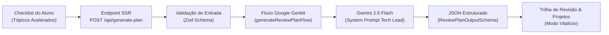

# 🚀 IA Course Tracker & Study Hub

> Plataforma inteligente para acompanhamento de estudos, aceleração de certificações e planejamento de maestria técnica vitalícia com Inteligência Artificial.

[](https://angular.dev/)
[](https://tailwindcss.com/)
[](https://firebase.google.com/docs/genkit)
[](https://nx.dev/)
[](https://www.typescriptlang.org/)
[](https://www.cypress.io/)
[](https://render.com/)

---

## 📌 1. Visão Geral do Projeto

O **IA Course Tracker** é uma aplicação web full-stack moderna desenvolvida em **Angular 21 (SSR & Signals)** com arquitetura de monorepo gerenciada pelo **Nx**.

A aplicação foi desenhada para resolver um dilema comum entre alunos de especializações técnicas de alta complexidade em Inteligência Artificial: conciliar o **prazo rígido da instituição para a emissão do certificado** com a necessidade real de **dominar os conceitos de forma profunda e prática** no longo prazo.

---

## 🎯 2. Objetivo e Finalidade

### O Desafio
O estudante possui **acesso vitalício** ao acervo de aulas e materiais, mas precisa cumprir o **calendário de provas para certificar-se**. Esse cenário exige uma **estratégia de estudo em dois tempos**:

1. **Fase de Aceleração (Curto Prazo - Foco no Certificado):**  
   Cobrir o conteúdo essencial, realizar exercícios orientados a testes e aprovar as avaliações no prazo exigido.
2. **Fase de Aprofundamento (Longo Prazo - Modo Vitalício):**  
   Retornar com calma a todos os tópicos que foram acelerados apenas para a prova, construindo projetos práticos de portfólio para consolidar maestria profissional.

### A Solução
O hub permite classificar cada um dos **73 tópicos distribuídos em 10 módulos oficiais** através de 4 estados mutuamente exclusivos:
- **`pending` (Pendente):** Tópico ainda não iniciado.
- **`deep_study` (Estudado a Fundo):** Tópico estudado com calma, com notas e exercícios práticos consolidados.
- **`accelerated` (Acelerado / Prova Feita):** Tópico concluído em ritmo acelerado para aprovação na avaliação do certificado.
- **`review_later` (Voltar com Calma):** Dívida técnica de aprendizado explicitamente sinalizada para estudo no modo vitalício.

---

## ⚡ 3. O Que Dá e O Que NÃO Dá Para Fazer

### ✅ O Que Dá Para Fazer
- **Acompanhamento de 10 Módulos Oficiais (73 tópicos):** Cobrindo desde Fundamentos de IA, Prompt Engineering, MCP, Agentes Autônomos, até Arquitetura, Fine-Tuning e Governança.
- **Dashboard Reativo em Tempo Real:**
  - *Progresso do Certificado (%):* soma dos itens estudados a fundo e acelerados sobre o total de tópicos.
  - *Maestria Real (%):* percentual de itens estudados a fundo.
  - *Contadores Absolutos:* quantidade exata de itens em cada status.
- **Persistência Automática e Segura:** Dados sincronizados automaticamente via `localStorage` no browser com verificação segura de SSR (`isPlatformBrowser`), sem risco de hidratação quebrada no servidor.
- **Geração de Roadmap Pós-Certificado por IA:** A IA (Google Genkit + Gemini 2.5 Flash) analisa dinamicamente todos os tópicos marcados como acelerados e cria uma trilha com cronograma em semanas, carga horária e projetos de portfólio recomendados para cada assunto.
- **Acessibilidade e Usabilidade Plenas:** Navegação por teclado, estados visuais semânticos e conformidade com atributos WAI-ARIA (`aria-pressed`, `role="group"`, `aria-label`).
- **Deploy Declarativo Contínuo:** Configuração através do Blueprint `render.yaml` compilando front-end SSR e micro-BFF no mesmo serviço.

### ❌ O Que NÃO Dá Para Fazer (Limitações / Fora de Escopo)
- **Não é um player de vídeo ou LMS:** A ferramenta é um tracker de produtividade e mentoria; não hospeda nem reproduz as aulas gravadas da instituição.
- **Não realiza login corporativo/multiusuário na nuvem:** Por design inicial, o armazenamento do progresso é local por navegador (`localStorage`). Não há banco de dados SQL/NoSQL centralizado de usuários nesta versão.
- **Não sincroniza automaticamente entre diferentes aparelhos:** Alterações feitas no navegador desktop não refletem no celular sem exportação/importação manual.
- **Não executa correção automática de código (Auto-grader):** A IA atua como Tech Lead e Mentora propondo projetos práticos e roadmaps estruturados, mas não compila nem dá notas para o código escrito pelo aluno.

---

## 🤖 4. O Papel da Inteligência Artificial

A Inteligência Artificial desempenha um papel central e arquitetural no sistema através do **Google Genkit** e do modelo **Gemini 2.5 Flash**:



1. **Micro-BFF Integrado:** O servidor Express do Angular SSR expõe a rota `POST /api/generate-plan`.
2. **Schema Enforcement com Zod:** Assegura tipagem estrita tanto no payload recebido (`acceleratedTopics: string[]`) quanto na resposta estruturada devolvida pelo LLM.
3. **Persona de Mentor Sênior:** O Gemini assume o papel de Tech Lead de IA, avaliando a lista de tópicos acelerados e gerando:
   - Sumário Executivo encorajador e estratégico.
   - Estimativa total de semanas para domínio real (dedicando de 6 a 10h/semana).
   - Para cada matéria: nome exato, projeto de portfólio recomendado, horas práticas e nível de prioridade para o mercado (Alta, Média, Baixa).

---

## 🛠️ 5. Tecnologias, Frameworks e Linguagens

| Camada | Tecnologia | Propósito |
|---|---|---|
| **Monorepo** | [Nx 24](https://nx.dev/) | Orquestração do monorepo, dependências, build cache e testes integrados |
| **Linguagem** | [TypeScript 5.8](https://www.typescriptlang.org/) | Modo estrito (`strict: true`), tipagem estrita de domínio, contratos e DTOs |
| **Frontend Framework** | [Angular 21](https://angular.dev/) | Standalone Components, Signal-based reactivity (`signal`, `computed`), controle de SSR |
| **Estilização** | [Tailwind CSS 3.4](https://tailwindcss.com/) + PostCSS | Utility-first CSS, paleta de cores Adobe Color personalizada e tipografia Google Fonts |
| **Tipografia** | [Google Fonts](https://fonts.google.com/) | `Arima Madurai` (cabeçalhos) e `Mulish` (textos, tabelas e botões) |
| **IA & LLM** | [Google Genkit](https://firebase.google.com/docs/genkit) + `@genkit-ai/google-genai` | Orquestração de prompts, structured output e invocação do Gemini 2.5 Flash |
| **Backend & SSR** | Node.js 22 + [Express 4](https://expressjs.com/) + `@angular/ssr` | Server-Side Rendering integrado ao Micro-BFF de rotas de API |
| **Validação de Schemas**| [Zod](https://zod.dev/) | Validação de payloads em tempo de execução nos endpoints da API |
| **Testes Unitários** | Vitest / Jest | Testes unitários para serviços, componentes, utilitários e fluxos Genkit |
| **Testes E2E** | [Cypress 16](https://www.cypress.io/) | Testes ponta a ponta validando fluxo de seleção, métricas e persistência |
| **Deploy & Hosting** | [Render](https://render.com/) | Web Service unificado gerenciado declarativamente por `render.yaml` |

---

## 📁 6. Estrutura do Projeto & Clean Architecture

O projeto adota rigorosamente a separação de responsabilidades (SRP) e Clean Architecture:

```
ia-study-hub/
├── apps/
│   ├── frontend/                       # Aplicação Angular 21 Standalone com SSR
│   │   ├── src/
│   │   │   ├── app/
│   │   │   │   ├── core/               # Inicialização, configs globais de SSR e client
│   │   │   │   ├── features/
│   │   │   │   │   └── checklist/      # Feature principal: UI da checklist e dashboard
│   │   │   │   ├── services/           # Estado reativo e persistência (SyllabusService)
│   │   │   │   └── shared/             # Componentes atômicos reutilizáveis (BadgeComponent)
│   │   │   ├── flows.ts                # Definição e execução do fluxo Genkit
│   │   │   ├── server.ts               # Servidor Express (Micro-BFF e Angular SSR)
│   │   │   ├── index.html              # Importação das fontes Arima Madurai e Mulish
│   │   │   └── styles.css              # Diretivas Tailwind e estilização base do body
│   │   └── project.json
│   └── frontend-e2e/                   # Suíte de testes E2E com Cypress
│       └── src/e2e/
│           └── checklist.cy.ts         # Testes dos cenários críticos de negócio
├── libs/
│   └── shared-types/                   # Biblioteca de domínio pura (modelos, ementa, DTOs)
│       └── src/
│           ├── index.ts
│           └── lib/shared-types.ts     # Matriz com 10 módulos (73 tópicos) e métricas
├── prompts/
│   ├── README.md                       # Documentação de System Instructions
│   └── guia-prompts.md                 # Caderno completo dos prompts estruturados
├── tailwind.config.js                  # Cores de marca estendidas e fontes customizadas
├── render.yaml                         # Blueprint de infraestrutura como código para Render
└── package.json
```

---

## 📖 7. Caderno de Prompts Estruturados

Todos os prompts originais utilizados no planejamento, arquitetura, design de componentes, IA e infraestrutura estão catalogados no arquivo:

👉 **[Caderno de Prompts Estruturados (`prompts/guia-prompts.md`)](./prompts/guia-prompts.md)**

O caderno inclui:
1. Setup Automatizado do Nx Monorepo
2. Prompt 1: Configuração do Tailwind CSS e Fontes
3. Prompt 2: Contrato de Dados da Ementa Oficial (`shared-types`)
4. Prompt 3: Serviço Reativo com Signals e SSR Safe Storage (`SyllabusService`)
5. Prompt 4: UI da Checklist com Tailwind CSS e Acessibilidade (WAI-ARIA)
6. Prompt 5: Fluxo de IA com Google Genkit para Plano de Revisão (`flows.ts`)
7. Prompt 6: Micro-BFF no `server.ts` do Angular SSR
8. Prompt 7: Testes E2E com Cypress
9. Prompt 8: Configuração de Deploy Declarativo no Render
10. Prompt 9: Guardião de Arquitetura Limpa, Clean Code e Tipagem Estrita

---

## 💻 8. Como Executar o Projeto Localmente

### Pré-requisitos
- **Node.js:** Versão 20.x ou superior (recomendado 22.x LTS)
- **npm:** Versão 10.x ou superior
- **Chave da API Google Gemini:** Obtida gratuitamente no [Google AI Studio](https://aistudio.google.com/)

### 1. Clonar o repositório e instalar dependências
```bash
git clone https://github.com/SEU_USUARIO/ia-study-hub.git
cd ia-study-hub
npm install
```

### 2. Configurar variáveis de ambiente
Crie um arquivo `.env` na raiz do projeto (ou exporte no seu terminal):
```env
GEMINI_API_KEY="sua_chave_de_api_aqui"
PORT=4200
```

### 3. Rodar a aplicação em modo de desenvolvimento
```bash
npx nx serve frontend
```
Acesse a aplicação no navegador em: `http://localhost:4200`

---

## 🧪 9. Como Executar os Testes

### Testes Unitários
Os testes unitários cobrem serviços, componentes, utilitários matemáticos e validações de fluxo Genkit:
```bash
# Executar todos os testes unitários do workspace
npm run test:all

# Executar testes unitários do frontend
npx nx test frontend

# Executar testes unitários da biblioteca de domínio
npx nx test shared-types
```

### Validação de Qualidade de Código (Linting)
```bash
# Executar lint em todos os projetos (frontend, shared-types e e2e)
npm run lint:all
```

### Testes End-to-End (Cypress)
Para rodar a suíte E2E automatizada contra o checklist:
```bash
npx nx e2e frontend-e2e
```
*Cenários validados:*
1. Carregamento inicial com tipografia correta e métricas zeradas em 0%.
2. Atualização reativa de status, badges com Tailwind e exclusão mútua de chips.
3. Persistência de dados reidratada com sucesso via `localStorage` após recarga de página (`cy.reload()`).

---

## ☁️ 10. Como Hospedar e Fazer Deploy (Render)

A aplicação está configurada para deploy contínuo em **serviço único** no [Render](https://render.com/), utilizando o arquivo declarativo [`render.yaml`](./render.yaml).

### Build e Inicialização de Produção
1. **Comando de Build:**
   ```bash
   npm install && npx nx build frontend --configuration=production
   ```
2. **Comando de Inicialização:**
   ```bash
   node dist/apps/frontend/server/server.mjs
   ```

### Deploy via Blueprint no Render
1. Conecte seu repositório GitHub ao dashboard do Render.
2. Selecione a opção **"New -> Blueprint"**.
3. Aponte para o repositório; o Render detectará automaticamente o arquivo `render.yaml`.
4. Defina o valor da variável de ambiente `GEMINI_API_KEY` com a sua credencial do Google AI Studio no painel do serviço.
5. Clique em **"Apply"**. O deploy será realizado e a aplicação estará acessível na URL gerada pelo Render com suporte a SSR e API de IA no mesmo domínio.

---

## 📄 Licença
Distribuído sob a licença MIT. Consulte o arquivo `LICENSE` para mais informações.
